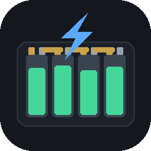
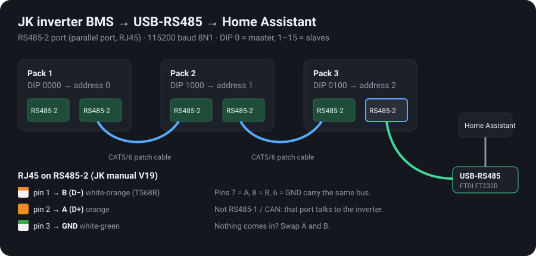

<h1> JK BMS Smart</h1>

JK inverter-BMS'en (PB-serie, bijv. JK-PB2A16S20P / 30P) rechtstreeks in Home Assistant via RS485 — met een USB-RS485-stick of een RS485-netwerkgateway. Geen add-on, geen MQTT, geen ESP32. Elke BMS wordt een eigen apparaat, samen vormen ze één accubank, en de kaarten tekenen je pakketten met alle prismatische cellen.

**Taal / Language / Sprache:** [Nederlands](#nederlands) · [English](#english) · [Deutsch](#deutsch)

## Nederlands

### Wat het doet

- **Plug and play.** Kies je USB-RS485-stick (de meest waarschijnlijke staat bovenaan) en de integratie zoekt zelf alle BMS'en op de bus, met model, aantal cellen, spanning en lading.
- **Werkt met en zonder master-BMS.** Heeft één BMS DIP-adres 0, dan is die de master en vraagt die de andere uit; Home Assistant luistert dan alleen mee en zendt nooit iets (geen botsingen op de bus). Hebben alle BMS'en een adres vanaf 1, dan vraagt Home Assistant ze zelf uit. Dat wordt automatisch herkend.
- **Geen spook-apparaten.** Elk 300-byte JK-frame wordt met checksum gecontroleerd en aan een adres gekoppeld via de Modbus-bevestiging (met CRC) die erna komt. Het instellingenframe bevat het adres nog een keer als controle. Verminkte frames worden weggegooid in plaats van als "nieuwe BMS" te verschijnen, en adressen die niet bij het instellen zijn gevonden worden nooit automatisch toegevoegd.
- **Alles per BMS:** lading, spanning, stroom, vermogen, resterende/volle capaciteit, opgeslagen kWh, gezondheid, cycli, alle celspanningen, laagste/hoogste/gemiddelde cel en het verschil, balanceerstroom en -status, MOS-temperatuur en tot vijf accutemperaturen, laad-/ontlaad-MOSFET, verwarming, alarmen (in gewone taal), geladen/ontladen kWh voor het Energie-dashboard, en de beveiligingsinstellingen (alleen lezen). Draadweerstand per cel staat als diagnostiek klaar.
- **Accubank:** totale lading (gewogen naar capaciteit), vermogen, stroom, opgeslagen energie, laagste en hoogste cel van de hele bank (met pakket en celnummer), warmste punt, en een probleemmelding als een pakket alarm geeft of stil valt.
- **Kaarten** in dezelfde donkere stijl als Easee Smart Charging:
  - *Accupakket*: het pakket van bovenaf met alle prismatische cellen in serie (polen, busbars, B−/B+ naar de BMS-print), vulniveau en afwijking per cel, MIN/MAX gemarkeerd, de actieve balancer als bewegende boog van de hoogste naar de laagste cel, stroom die zichtbaar in- of uitloopt, LED's voor laden/ontladen/balanceren. Tabbladen Cellen (staafjes + draadweerstand), Beveiliging (spanningsvenster en grenzen) en Info (model, firmware, serienummer, alarmen).
  - *Accubank*: alle pakketten naast elkaar met hun cellen in miniatuur, totale lading en vermogen, tijd tot vol/leeg en het ladingsverschil tussen de pakketten.
  - *Grafieken*: lading, vermogen (laden groen, ontladen oranje), alle 16 cellen tegelijk (tik op een cel om hem te markeren), celverschil met min/max-band, temperaturen, spanning en stroom, en geladen/ontladen kWh per dag of maand — over 6 uur, 24 uur, 7 dagen, 30 dagen of een jaar. Alles komt uit de eigen statistieken van Home Assistant, dus het is licht en gaat ver terug. Ook als tabblad *Grafieken* in de pakketkaart.
  - *Gezondheid*: welke cel als eerste leeg raakt (de zwakste cel) en welke als eerste vol is, het grootste celverschil per dag, en de draadweerstand per cel per dag — een losse busbar of aansluiting zie je zo langzaam oplopen.
  - *Instellingen*: alle instellingen per pakket of voor alle pakketten tegelijk wijzigen (zie hieronder).
- **Instellingen wijzigen** (zet het aan via *Configureren → Verversen*): laden/ontladen/balanceren aan-uit, alle celspanningsgrenzen, balancer, stromen, capaciteit, temperatuurgrenzen met hun herstelwaarden, vertragingen en hersteltijden bij overstroom en kortsluiting, en de slaapspanning. Met een master-BMS stuurt de integratie een wijziging in een stil moment op de bus en controleert de bevestiging van de BMS. Combinaties die het pakket meteen zouden laten afschakelen (bijv. herstel boven de beveiliging) worden geweigerd.
- **Pakketten gelijk trekken.** Verschillen de instellingen tussen je pakketten, dan zie je dat op de kaarten, als binaire sensor en in *Reparaties*. Eén knop laat zien wat er per pakket verandert en zet het daarna gelijk, in een veilige volgorde.
- **Back-ups.** Vóór elke wijziging wordt automatisch een back-up van het pakket gemaakt (in `config/jk_bms_smart/backups`), en je kunt er zelf een maken en elke back-up terugzetten (eerst met een overzicht van wat er verandert).
- **Meldingen op je telefoon** (*Configureren → Meldingen*): pakket of RS485-verbinding weg, BMS-alarm, cellen lopen uit elkaar, te warm of te koud, accubank bijna leeg, of instellingen verschillen. Met eigen grenzen, wachttijden tegen loze meldingen en een bericht als het weer opgelost is.
- **Reparaties.** RS485-verbinding weg, een pakket dat langer dan 10 minuten niets stuurt, of verschillende instellingen verschijnen in *Instellingen → Reparaties* en verdwijnen vanzelf als het opgelost is.
- **Dashboard met één druk:** *Configureren → Dashboard aanmaken* (tabbladen Accupakketten, Cellen, Grafieken en Instellingen; nog eens drukken ververst hem).
- Nederlands, Engels en Duits.

Zonder dat je *Instellingen wijzigen* aanzet, leest de integratie alleen en verandert ze niets in de BMS.

### Installatie

1. Installeer **JK BMS Smart** via HACS (knop hierboven) en herstart Home Assistant.
2. **Gebruikt een add-on de RS485-stick al (bijvoorbeeld een JK BMS-add-on), zet die dan uit.** Twee programma's tegelijk op één seriële poort gaat niet goed.
3. *Instellingen → Apparaten & diensten → Integratie toevoegen → JK BMS Smart*, kies *USB-RS485-stick* en de stick. Na maximaal 40 seconden zie je de gevonden BMS'en; geef ze een naam.
4. *Configureren → Dashboard aanmaken*, of zet de kaarten zelf op een dashboard (*JK BMS Smart – Accupakket* en *– Accubank* in de kaartkiezer).

### Wat heb je nodig

1. **Een USB-naar-RS485-adapter.** Het liefst een met een **FTDI FT232R**-chip (bijvoorbeeld Waveshare *USB TO RS485 (B)* of DSD TECH *SH-U11*); die werkt het stabielst op 115200 baud. Een galvanisch gescheiden (isolated) uitvoering is een pluspunt bij een grote accubank. Goedkope CH340-sticks werken vaak ook, maar missen soms frames. Heb je de Home Assistant-server niet bij de accu staan, dan kan het ook met een RS485-netwerkgateway (Elfin EW11, USR-TCP232, Waveshare RS485 TO ETH) in transparante TCP-servermodus, 115200 8N1.
2. **Een netwerkkabel (CAT5/6) die je aan één kant doorknipt.** Aan de BMS-kant gaat de RJ45-stekker erin, aan de adapterkant gebruik je drie aders (T568B-kleuren):
   - pin 1 (wit-oranje) → **B / D−**
   - pin 2 (oranje) → **A / D+**
   - pin 3 (wit-groen) → **GND**

   Komt er niets binnen, wissel dan A en B om; dat beschadigt niets.
3. **De juiste poort.** Op de communicatieprint van de JK inverter-BMS (het groene printje met de RJ45-bussen en de DIP-schakelaar) zitten:
   - **RS485-2** (twee bussen, "parallel"): hiermee zijn de pakketten aan elkaar doorgelust. **Hier prik je de adapter in**, in de vrije RS485-2-bus van het eerste of laatste pakket in de rij. Heb je maar één pakket, dan gebruik je een van de twee RS485-2-bussen.
   - **CAN / RS485-1**: die gaat naar de omvormer (Victron, Deye, …). Daar blijf je vanaf; de integratie heeft hem niet nodig en je omvormer blijft gewoon werken.
4. **DIP-adressen.** Elk pakket een eigen adres. Gebruik je de accu's met een omvormer via CAN, dan is één BMS adres **0** (master) en de rest 1, 2, 3 … De integratie herkent de master en luistert dan alleen mee. Zonder master (alle adressen vanaf 1) vraagt Home Assistant de pakketten zelf uit. Schakelaar 1 = 1, 2 = 2, 3 = 4, 4 = 8 (adres 1: schakelaar 1 aan; adres 2: schakelaar 2 aan; adres 3: 1 en 2 aan).
5. In de BMS hoef je niets in te stellen: RS485-2 staat standaard op 115200 baud.

### Problemen oplossen

- *Poort in gebruik*: een add-on of ander programma heeft de stick nog open.
- *Geen BMS gevonden*: A/B omwisselen, kabel controleren, of het DIP-adres. Downloaddiagnostiek op de integratie laat zien hoeveel bytes en geldige frames er binnenkomen.
- Pakket toegevoegd of DIP-adres gewijzigd: *Configureren → Opnieuw zoeken*.

## English

Read JK inverter BMS units (PB series) straight into Home Assistant over RS485 — USB-RS485 stick or RS485 network gateway, no add-on, no MQTT. The flow finds every BMS on the bus, detects whether a master BMS (DIP address 0) is present (then Home Assistant only listens) or polls the units itself. Frames are checksummed and attributed to an address through the CRC-checked Modbus acknowledgement, so line noise never turns into ghost devices. Every pack gets all cell voltages, balancer, temperatures, MOSFET states, alarms, energy counters and its protection settings; the battery bank gets totals. Cards draw the packs with their prismatic cells (balancer animation, min/max cells, current flow) and the whole bank; a chart card shows charge, power, all 16 cells, cell difference, temperatures and energy per day from 6 hours to a year, plus pack health (which cell runs out first, daily cell difference, wire resistance per cell). With *Allow changing BMS settings* on you can change every protection, balancer, current, temperature, delay and sleep setting per pack or for all packs, make the packs equal with one button (preview first), and back up / restore settings (an automatic backup is made before changes). Phone notifications (offline, alarms, cell drift, temperature, low battery, different settings) and Repairs issues are built in. *Configure → Create dashboard* adds a ready-made dashboard.

Install via HACS, restart, **stop any add-on that uses the stick**, then add *JK BMS Smart*.

**What you need:** a USB-RS485 adapter, preferably with an **FTDI FT232R** chip (e.g. Waveshare *USB TO RS485 (B)*, DSD TECH *SH-U11*; an isolated one is a plus), or an RS485 network gateway (Elfin EW11, USR-TCP232) in transparent TCP mode. Cut a CAT5/6 cable: RJ45 **pin 1 = B (D−)**, **pin 2 = A (D+)**, **pin 3 = GND** (T568B: white-orange, orange, white-green). Plug it into the free **RS485-2** (parallel) socket of the first or last pack on the communication board, **not** into CAN / RS485-1 (that one goes to the inverter). Give every pack its own DIP address; with an inverter on CAN one pack is address 0 (master) and the integration only listens. Nothing comes in? Swap A and B. See the diagram above.

## Deutsch

Liest JK-Inverter-BMS (PB-Serie) direkt per RS485 in Home Assistant — USB-RS485-Stick oder RS485-Netzwerk-Gateway, ohne Add-on und ohne MQTT. Die Einrichtung findet alle BMS am Bus und erkennt, ob ein Master-BMS (DIP-Adresse 0) vorhanden ist (dann hört Home Assistant nur mit) oder ob Home Assistant selbst abfragt. Frames werden per Prüfsumme und CRC-geprüfter Modbus-Bestätigung einer Adresse zugeordnet — keine Geistergeräte mehr. Pro Pack: alle Zellspannungen, Balancer, Temperaturen, MOSFETs, Alarme, Energiezähler und Schutzeinstellungen; für die Akkubank Summen. Karten zeigen die Packs mit ihren prismatischen Zellen, die ganze Bank und Diagramme (Ladung, Leistung, alle Zellen, Zelldifferenz, Temperaturen, Energie pro Tag, Zustand der Zellen). Optional: alle Einstellungen ändern, Packs angleichen, Sicherung/Wiederherstellung, Handy-Benachrichtigungen und Reparatur-Meldungen. *Konfigurieren → Dashboard erstellen* legt ein fertiges Dashboard an.

Über HACS installieren, neu starten, **ein Add-on, das den Stick nutzt, stoppen**, dann *JK BMS Smart* hinzufügen.

**Was du brauchst:** einen USB-RS485-Adapter, am besten mit **FTDI FT232R** (z. B. Waveshare *USB TO RS485 (B)*, DSD TECH *SH-U11*; galvanisch getrennt ist ein Plus), oder ein RS485-Netzwerk-Gateway (Elfin EW11, USR-TCP232) im transparenten TCP-Modus. Ein CAT5/6-Kabel abschneiden: RJ45 **Pin 1 = B (D−)**, **Pin 2 = A (D+)**, **Pin 3 = GND** (T568B: weiß-orange, orange, weiß-grün). In die freie **RS485-2**-Buchse (Parallel) des ersten oder letzten Packs auf der Kommunikationsplatine stecken, **nicht** in CAN / RS485-1 (die geht zum Wechselrichter). Jedes Pack braucht eine eigene DIP-Adresse; mit Wechselrichter per CAN ist ein Pack Adresse 0 (Master) und die Integration hört nur mit. Kommt nichts an? A und B tauschen. Siehe Schema oben.

---

Not affiliated with JK BMS / Jikong. Protocol: JK "BMS RS485 Modbus V1.0/V1.1".
